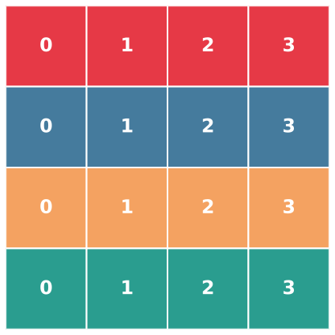
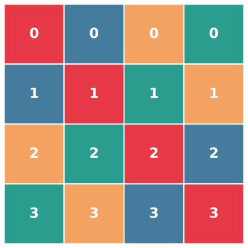
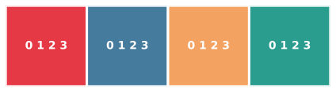

# Linear Layouts For Dummies

A layout is just a function that given a thread id, tells you which elements of a tensor that thread holds.

Imagine the most simple example: We have 8 threads storing an 8-element array, one element each:

```
Thread:  0  1  2  3  4  5  6  7
Element: 0  1  2  3  4  5  6  7
```

Now notice something about the binary representations of the threads:

```
0 0x000 -> 0x000
1 0x001 -> 0x001
2 0x010 -> 0x010
3 0x011 -> 0x011 (0x001 ^ 0x010)
4 0x100 -> 0x100
5 0x101 -> 0x101 (0x100 ^ 0x001)
6 0x110 -> 0x110 (0x100 ^ 0x010)
7 0x111 -> 0x111 (0x100 ^ 0x010 ^ 0x001)
```

Aka: We can compose any arbitary number by composing the bits with XOR in powers of two. This is the trick applied in linear layouts: we define functions mapping the thread ID to element for the only the powers of two, and compose these together with XOR.

We call the power of 2 elements "basis vectors", can composing a "linear combination over GF(2)".

Some terminology:

- Injective: one-to-one, each output has one input. No dups
- Surjective: Every output has at least one input. No gaps.
  - Triton asserts that linear layouts are surjective unless you explicitly say otherwise


## Going 2D

Now instead of a single thread index, we have two dimensions: `(t, w)` for thread and warp. And lets now use a 2D `(x, y)` array. For a simple case, each warp will process one row.

{width=300px}

- Warp 0: Red
- Warp 1: Blue
- Warp 2: Orange
- Warp 3: Turquoise

```
L(1, 0) = (0, 1)
L(2, 0) = (0, 2)
L(0, 1) = (1, 1)
L(0, 2) = (1, 2)
```

We can then compute `L(3, 2)`:

```
t=3 => 0x11 => L(1, 0) ^ L(2, 0) => (0, 1) ^ (0, 2)
w=2 => 0x10 => L(0, 2) => (2, 0)
L(3, 2) => (0, 1) ^ (0, 2) ^ (2, 0) => (2, 3)
```

Great, so we can see how we can do more interesting layouts.

## Bank conflict swizzle

{width=300px}

This layout minimizes bank conflict between the threads, and is a nice intro example since the thread idx affects both x and y.

```
L(thread, warp) = (x, y)
L(1, 0) = (1, 1)
L(2, 0) = (2, 2)
L(0, 1) = (0, 1)
L(0, 2) = (0, 2)
```

```
L(thread=1, warp=3)
=> L(1, 0) ^ L(0, 1) ^ L(0, 2)
=> (1, 1) ^ (0, 1) ^ (0, 2)
=> (1, 2)
```

## Broadcasting - multiple hardware locations map to the same tensor element

{width=300px}

```
L(thread, warp)
# thread is a NOOP, all access same element
L(1, 0) = (0,)
L(2, 0) = (0,)
# warps control layout
L(0, 1) = (1,)
L(0, 2) = (2,)
```

- Non-injective: multiple hardware locations map to same tensor element
- Requires zeros in basis vectors

---

## Tiling

## Composing layouts

Its super easy to compose layouts - we just XOR them together!

## Gluon

reg,thread,warp,block

This is usually how layouts are defined in [gluon](https://github.com/triton-lang/triton/blob/26d005b55a5e3fcce362fd6538a00b132c26564e/python/triton/experimental/gluon/language/_layouts.py#L158).

Reg: Each thread can store multiple values

```python
gl.DistributedLinearLayout(
    reg_bases=[],
    lane_bases=[[1], [2]],
    warp_bases=[],
    block_bases=[],
)
```


